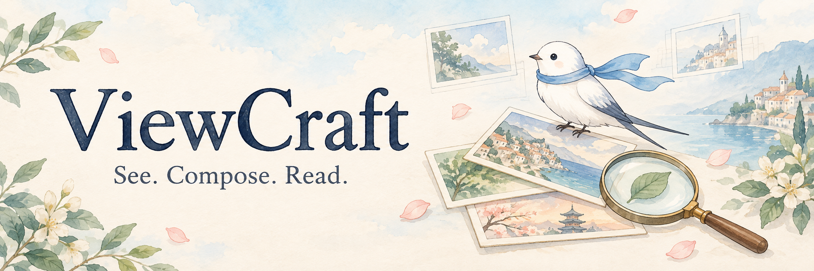
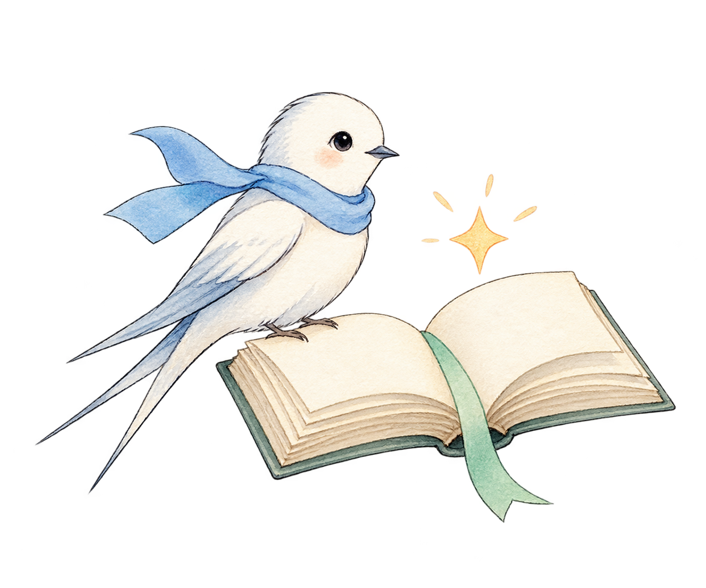

<div align="center">

<a href="https://little-fridge.github.io/ViewCraft-page/"></a>

### Evolving What Multimodal Agents See and How They Read It

[](https://little-fridge.github.io/ViewCraft-page/)
[](https://arxiv.org/abs/2610.15915)
[](skill-library/README.md)

Binxiao Xu · Ruichuan An · Bocheng Zou · Weihua Du · Xinyu Wei<br>
Hangyu Guo · YiFan Zhang · Renye Yan · Chengqi Duan · Hang Hua

[Quickstart](#quickstart) · [Method](#method) · [Skills](#skill-library) · [Documentation](#documentation) · [Citation](#citation)

<sub>Python 3.11+ &nbsp; · &nbsp; MIT License &nbsp; · &nbsp; Frozen executor weights</sub>

</div>

---

ViewCraft evolves **what a multimodal agent sees and how it reads the evidence**.
It learns observation selection, visual transformations, layout and reading
instructions together, then exports them as a reusable skill. Model weights stay fixed.

| Eight benchmarks | Matched input-token budget | Five multi-source tasks |
| :---: | :---: | :---: |
| **+6.1** mean task-score points vs. Direct | **+5.2** points vs. token-matched Direct | **8–15%** fewer input tokens vs. Initial skill |

<sub>Results reported in the paper's benchmark evaluation; see [release scope](docs/release.md) for artifact details.</sub>

<p align="center">
  <a href="https://little-fridge.github.io/ViewCraft-page/"></a>
</p>

## Quickstart

Python **3.11+** on Linux or macOS. A hosted vision-model endpoint needs no local GPU.

```bash
git clone https://github.com/Little-Fridge/ViewCraft.git
cd ViewCraft
python -m venv .venv
source .venv/bin/activate
python -m pip install -r requirements.txt

# Validate the bundled evolution example without model calls.
python scripts/evolve.py --task examples/counting/task.yaml --check
```

Configure image-capable executor and optimizer models:

```bash
export OPENAI_API_KEY='your-key'
export VIEWCRAFT_ENDPOINT='https://your-server/v1/chat/completions'
export VIEWCRAFT_EXECUTOR_MODEL='your-vision-executor-model'
export VIEWCRAFT_OPTIMIZER_MODEL='your-vision-optimizer-model'
```

Use a skill on your own image:

```bash
python scripts/use_skill.py \
  --skill dense-counting \
  --images your-image.png \
  --question 'How many target objects are visible? Give region subtotals.'
```

For PDFs or videos, install `requirements-media.txt` and pass the original file:

```bash
python -m pip install -r requirements-media.txt
python scripts/use_skill.py --skill pdf-reading --pdf report.pdf \
  --question 'Summarize the main findings with page references.'
```

Or evolve a skill and evaluate it on held-out items:

```bash
python scripts/evolve.py --task examples/counting/task.yaml --run-id counting-demo
python scripts/evolve.py --task examples/counting/task.yaml --run-id counting-demo --stage test
```

Execution calls your configured model service. The small bundled example contains
6 train / 3 gate / 3 test items and runs two evolution rounds; it is a software
example, not a reproduction of the paper's benchmark tables.
See [configuration](docs/configuration.md) for endpoint options and
[the tutorial](docs/tutorial.md) to bring your own data.

## Method

<table>
<tr>
<td align="center" width="33%"><br><b>See</b><br><sub>Select observations, crops and visual transformations.</sub><br><br><code>VIEW.yaml</code></td>
<td align="center" width="33%"><br><b>Arrange</b><br><sub>Organize views, labels and context.</sub><br><br><code>LAYOUT.yaml</code></td>
<td align="center" width="33%"><br><b>Read</b><br><sub>Inspect, compare and reason from the evidence.</sub><br><br><code>SKILL.md</code></td>
</tr>
</table>

Execution traces guide joint revisions. Visual replay and execution checks screen
them; paired development evaluation decides what to retain. Eligible rejected
joint edits can retry the proposed interface with the incumbent reader.

The final snapshot is saved under
`runs/<run-id>/arms/viewcraft/snapshots/final/`. Apply it to a new question:

```bash
python scripts/predict.py \
  --skill runs/counting-demo/arms/viewcraft/snapshots/final \
  --images your-image.png \
  --question 'How many target objects are visible?' \
  --output prediction.json
```

## Skill library

Ten ready-to-run task skills for documents, images and video.
Each includes reading instructions, observation settings and a view-context contract.

| Skill | What you can do |
| :--- | :--- |
| [PDF reading](skill-library/pdf-reading) | Locate cross-page evidence and answer with page references. |
| [Dense counting](skill-library/dense-counting) | Count by region without counting the same object twice. |
| [Spot differences](skill-library/spot-differences) | Find additions, removals, relocations and visual changes. |
| [Maze solving](skill-library/maze-solving) | Trace routes and verify each passage against the walls. |
| [Chart reading](skill-library/chart-reading) | Interpret series, axes, units and quantitative comparisons. |
| [Table extraction](skill-library/table-extraction) | Convert visual tables into CSV, JSON or Markdown. |
| [Document comparison](skill-library/document-comparison) | Align versions and identify changed values or clauses. |
| [Screenshot troubleshooting](skill-library/screenshot-troubleshooting) | Read visible errors and identify the next useful check. |
| [Video event localization](skill-library/video-event-localization) | Track actions and changes through timestamped frames. |
| [Diagram understanding](skill-library/diagram-understanding) | Follow arrows, branches, dependencies and loops. |

Run these skills directly on your files; no optimization stage is required. The runner accepts images, PDFs and videos, and saves the complete answer with its supporting evidence. [Commands and supported inputs →](skill-library/README.md)

## Documentation

| Start here | Reference |
| :--- | :--- |
| [Run your own task](docs/tutorial.md) | [Task and scoring format](docs/custom_tasks.md) |
| [Use a reusable skill](skill-library/README.md) | [Skill format and expressions](docs/skill_format.md) |
| [Configure models](docs/configuration.md) | [Benchmark adapters](docs/benchmarks.md) |
| [Environment and dependencies](docs/environment.md) | [Release scope](docs/release.md) |
| [Project website source](website/) | [GitHub Pages publishing](docs/website.md) |

<details>
<summary>Repository structure</summary>

```text
viewcraft/       Runtime, evolution, visual operations and scorers
scripts/         Evolve, predict and run skills
skill-library/   Ten reusable task skills
examples/        Minimal synthetic evolution task
configs/         Model and experiment settings
docs/            Tutorials and reference documentation
website/         Paper project page and publication assets
tests/           Offline software checks
```

</details>

## Citation

```bibtex
@misc{xu2026viewcraft,
  title         = {{VIEWCRAFT}: Evolving What Multimodal Agents See and How They Read It},
  author        = {Binxiao Xu and Ruichuan An and Bocheng Zou and Weihua Du and
                   Xinyu Wei and Hangyu Guo and YiFan Zhang and Renye Yan and
                   Chengqi Duan and Hang Hua},
  year          = {2026},
  eprint        = {2610.15915},
  archivePrefix = {arXiv},
  primaryClass  = {cs.CV},
  doi           = {10.48550/arXiv.2610.15915},
  url           = {https://arxiv.org/abs/2610.15915}
}
```

Paper: [arXiv:2610.15915](https://arxiv.org/abs/2610.15915).
Code is released under the [MIT License](LICENSE); external datasets retain their own terms.
