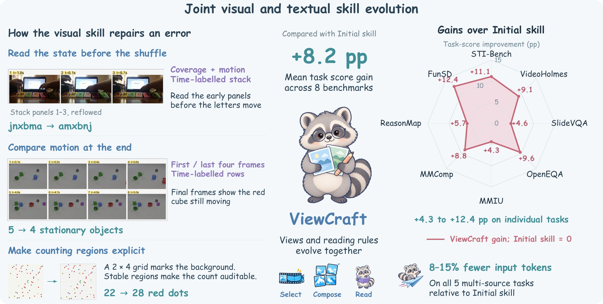
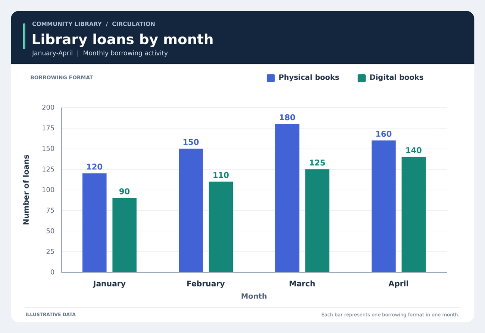
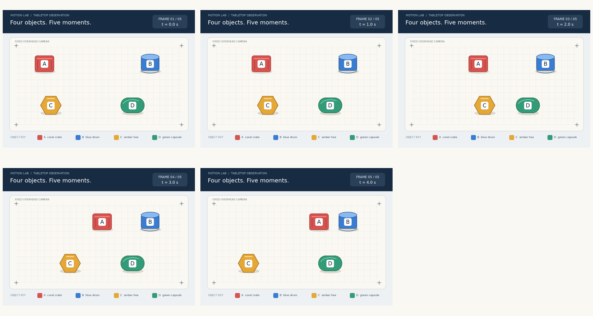
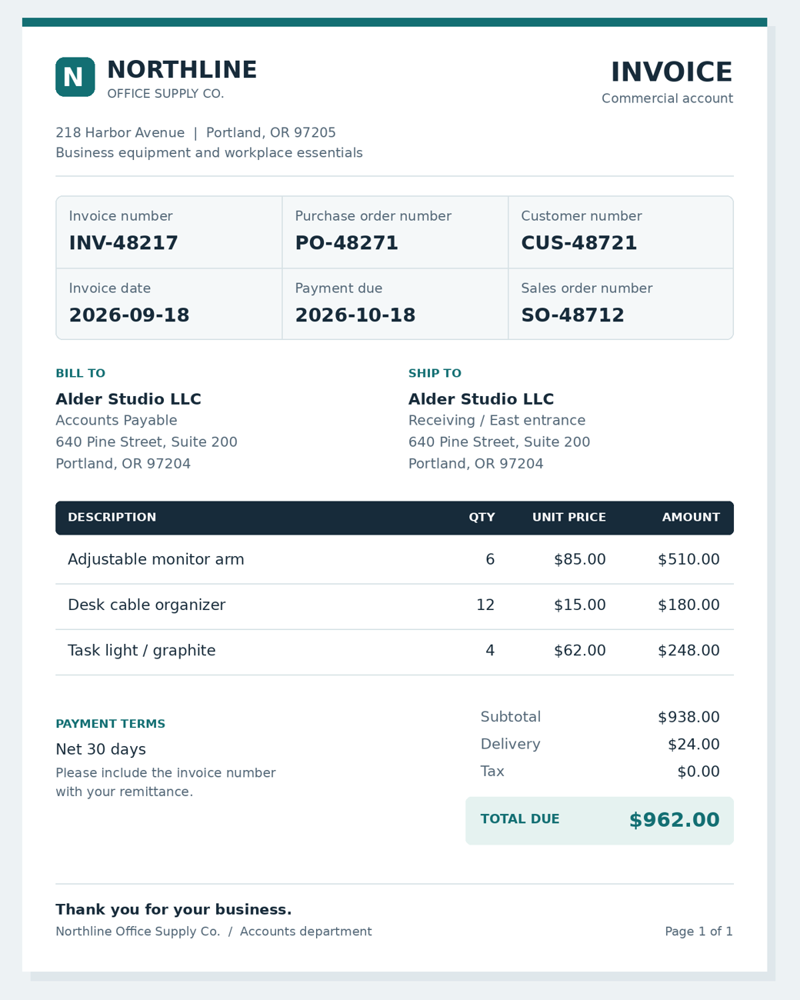

<div align="center">

# ViewCraft

### Evolving What Multimodal Agents See and How They Read It

**Better evidence. A reader that knows how to use it.**

[](#quickstart)
[](LICENSE)
[](#skill-gallery)
[](#how-it-works)

[Quickstart](#quickstart) · [Skill gallery](#skill-gallery) · [Your own task](docs/tutorial.md) · [Documentation](#documentation) · [Citation](#citation)

Binxiao Xu · Ruichuan An · Bocheng Zou · Weihua Du · Xinyu Wei<br>
Hangyu Guo · Renye Yan · YiFan Zhang · Hang Hua

</div>

ViewCraft jointly evolves an **executable visual evidence interface** and the
**procedure that reads its output**, while keeping the executor model frozen.
It learns how to select and arrange visual inputs, then saves those choices
with reading instructions as a skill you can reuse on new questions.

<p align="center">
  
</p>

> **Paper results:** +6.1 task-score points over Direct on average, with gains
> across all eight benchmarks; +5.2 points at a matched input-token budget.
> The figure above compares against **Initial skill** (+8.2 points).
> This repository provides the framework, synthetic examples, and skill gallery;
> the bundled demos do not reproduce the paper's benchmark tables.

## Skill gallery

Ten reusable skills cover image, document, video-frame, and interface tasks.
Start from a skill, supply your own images, or use it as an initialization for evolution.

<table>
<tr>
<td width="33%" align="center"><a href="gallery/chart-reading"><br><b>Read a chart</b></a><br>Locate the right series and compare values.</td>
<td width="33%" align="center"><a href="gallery/motion-state"><br><b>Compare motion</b></a><br>Match objects across ordered frames.</td>
<td width="33%" align="center"><a href="gallery/form-reading"><br><b>Read a form</b></a><br>Keep fields paired with their values.</td>
</tr>
</table>

| Images & spatial reasoning | Documents & structured data | Time & interaction |
| :--- | :--- | :--- |
| [Fine detail](gallery/detail-reading) | [Forms](gallery/form-reading) | [Temporal order](gallery/temporal-order) |
| [Object counting](gallery/object-counting) | [Charts](gallery/chart-reading) | [Motion state](gallery/motion-state) |
| [Image comparison](gallery/image-comparison) | [Tables](gallery/table-reasoning) | [Screen grounding](gallery/screen-grounding) |
| | [Multi-page questions](gallery/multi-page-qa) | |

**Browse locally:** open `gallery/index.html` in a browser after cloning.
It is a self-contained page with embedded images and fonts, so it also works offline.
GitHub displays HTML source rather than rendering the gallery.

Recorded cases include the actual model attachments, returned answers, and
portable replay pages. These are individual illustrative examples, not benchmark
accuracy measurements or evidence of evolution gains. See the [gallery guide](gallery/README.md).

## Quickstart

Python **3.11+**, Linux or macOS. No local GPU is needed with a hosted model endpoint.
Run commands from the repository root.

### 1. Install and check offline

```bash
git clone https://github.com/Little-Fridge/ViewCraft.git
cd ViewCraft
python -m venv .venv
source .venv/bin/activate
python -m pip install -r requirements.txt

# No model requests, API key, or dataset downloads.
python scripts/evolve.py --task examples/counting/task.yaml --check
python scripts/use_skill.py --skill chart-reading --check
```

The counting check prints `CHECK OK` with **6 train / 3 gate / 3 test** items.
The bundled task is intentionally small; a capable executor may accept no edits.

### 2. Connect your models

```bash
export OPENAI_API_KEY='your-key'
export VIEWCRAFT_ENDPOINT='https://your-server/v1/chat/completions'
export VIEWCRAFT_EXECUTOR_MODEL='your-vision-executor-model'
export VIEWCRAFT_OPTIMIZER_MODEL='your-vision-optimizer-model'
```

Use the **complete chat-completions URL**. Both model roles must accept images.
Evidence verification makes separate requests to the frozen executor.
[Model configuration](docs/configuration.md) explains separate endpoints, keys,
rate limits, token fields, and unauthenticated local servers.

### 3. Try a skill or evolve one

```bash
# Use a ready-made skill; record its actual model inputs and response.
python scripts/use_skill.py --skill chart-reading --record

# Evolve a skill on the bundled counting task, then evaluate held-out items.
python scripts/evolve.py --task examples/counting/task.yaml --run-id counting-demo
python scripts/evolve.py --task examples/counting/task.yaml --run-id counting-demo --stage test
```

These commands call your configured model service and may incur API costs.
The demo runs two evolution rounds. Use `--workers 1` to reduce concurrency;
edit `rounds` or `train_batch_size` in the task YAML for a smaller experiment.

The final skill is saved to:

```text
runs/counting-demo/arms/viewcraft/snapshots/final/
├── SKILL.md       # How to inspect and reason about the evidence
├── VIEW.yaml      # Which observations to select and transform
├── LAYOUT.yaml    # How to arrange and describe the resulting views
└── CONFIG_HASH
```

Apply it to a new question without an optimizer or reference answer:

```bash
python scripts/predict.py \
  --skill runs/counting-demo/arms/viewcraft/snapshots/final \
  --images examples/counting/images/09.png \
  --question 'How many red circles are in the image?' \
  --output prediction.json
```

**Bring your own task:** follow the [step-by-step tutorial](docs/tutorial.md)
to supply JSONL examples, an initial skill, and your scoring function.

## How it works

| Coordinate | What changes | Saved file |
| :--- | :--- | :--- |
| **φ · See** | Observation selection, crops, pixel/canvas transforms, zoom decisions | `VIEW.yaml` |
| **ψ · Arrange** | Layout, view descriptions, answer and action formats | `LAYOUT.yaml` |
| **θ · Read** | Instructions for inspecting evidence and producing answers | `SKILL.md` |

These are storage containers; the paper's logical reader/interface partition
is clause-based, so some reading instructions can appear in interface contracts.

1. **Run the current skill** on training examples and collect failure traces.
2. **Propose a joint revision** to the views and reading procedure.
3. **Replay and check execution**, then compare the candidate and current skill
   on the same gate items.
4. **Keep useful changes.** Eligible rejected joint edits can retry the candidate
   interface with the current reader, within the remaining evaluation budget.

The optimizer writes bounded expressions, such as
`grid(views, cols=2, label=index)`, rather than modifying the engine.
The test split is evaluated separately after evolution.

## Documentation

| Guide | What you will find |
| :--- | :--- |
| [Your own task](docs/tutorial.md) | Copy an example, supply data, choose a reward, and run evolution |
| [Task format](docs/custom_tasks.md) | JSONL schema, source-group splits, multiple choice, and custom scorers |
| [Configuration](docs/configuration.md) | Models, authentication, endpoints, budgets, and output locations |
| [Skill format](docs/skill_format.md) | Editable coordinates and supported expressions |
| [Benchmark adapters](docs/benchmarks.md) | Existing dataset entry points and benchmark configuration |
| [Environment](docs/environment.md) | Optional dependencies and platform notes |
| [Release scope](docs/release.md) | Included artifacts, verification, and reproduction boundaries |

<details>
<summary><b>Repository map</b></summary>

```text
ViewCraft/
├── viewcraft/        # Runtime, evolution, views, scorers, and dataset adapters
├── scripts/          # Evolve, predict, use skills, monitor, and build the gallery
├── configs/          # Portable model and experiment configurations
├── examples/         # Small synthetic counting task and initial skill
├── gallery/          # 10 skills, case inputs, and recorded model outputs
├── docs/             # Tutorials, reference guides, and paper overview
└── tests/            # Offline unit and end-to-end checks
```

</details>

<details>
<summary><b>Run outputs and resuming</b></summary>

Each run saves its initial skill, data/model/configuration manifest, snapshots,
decision history, trajectories, and metrics. Start with
`arms/viewcraft/history.json`, `metrics/evolution_summary.json`, and
`metrics/test_rows.jsonl`. `python scripts/monitor.py` shows a status summary.

Repeat the same command and run ID to resume completed rounds and reuse
completed items. Changes to task data, initial skill, scorer, models, settings,
or source code require a new run ID. Interrupted rounds may repeat proposals.
Set `VIEWCRAFT_RUNS_ROOT` to relocate outputs and caches.

</details>

## Development

```bash
python -m pip install -r requirements-dev.txt
python -m pytest -q
```

Tests include offline end-to-end evolution, resume, held-out evaluation, and
prediction using scripted model doubles. They check the software path, not real
model effectiveness. Regenerate example data with
`python examples/counting/make_data.py`; rebuild the gallery with
`python scripts/build_gallery.py`.

## Citation

```bibtex
@misc{xu2026viewcraft,
  title  = {ViewCraft: Evolving What Multimodal Agents See and How They Read It},
  author = {Binxiao Xu and Ruichuan An and Bocheng Zou and Weihua Du and
            Xinyu Wei and Hangyu Guo and Renye Yan and YiFan Zhang and Hang Hua},
  year   = {2026},
  note   = {Preprint}
}
```

Public paper and project-page links will be added when available.

## License

Code and bundled synthetic examples use the [MIT License](LICENSE).
External benchmark datasets retain their own terms.
[Comic Neue](gallery/assets/fonts/OFL.txt) is distributed under the SIL Open Font License.
