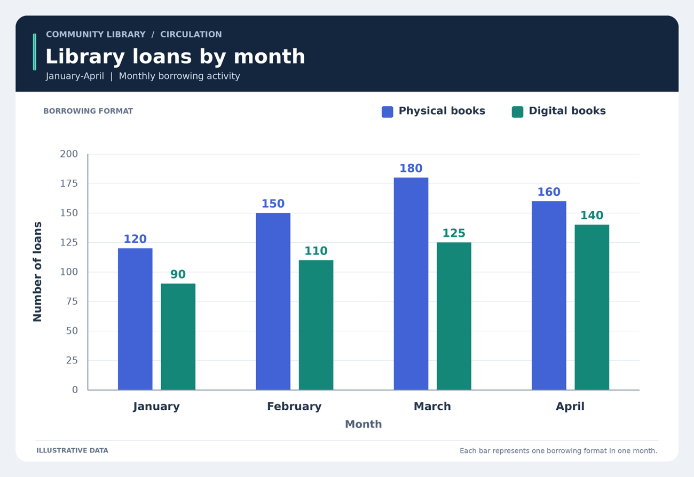

# Let the chart speak

Match bar colors to a legend, read category values, and answer a simple comparison or difference.

## The ViewCraft skill

- **What to see (φ):** Keep original colors, category labels and axis units. Inspect a bar pair or legend only when it is unclear.
- **How to arrange it (ψ):** Preserve the full chart as context; retain the legend and nearby ticks in detail views.
- **How to read it (θ):** Match the series to its legend, read values with units, then compute the requested comparison.



**Question:** In March, how many more physical books than digital books were borrowed? Answer with the number only.

**Recorded answer:** 55

This is one illustrative case, not a benchmark accuracy claim. The preview shows
original inputs. Exact model attachments and responses remain in the case records.

## Use it

```bash
python scripts/use_skill.py --skill chart-reading --record
```

For your own input add `--images my-image.png --question 'Your question'`.
For multi-image/video tasks provide ordered page images or extracted frames.
Use this directory as `initial_skill` to adapt it through `scripts/evolve.py`.
