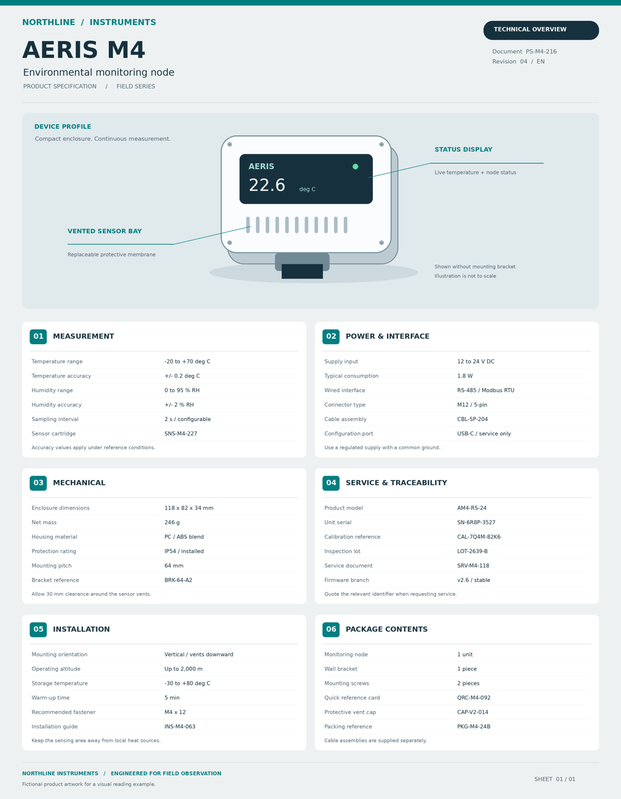

# Find the tiny detail

Locate and transcribe a small reference code among specification sections using a contextual overview and native-resolution detail crops.

## The ViewCraft skill

- **What to see (φ):** Start with the whole poster. Zoom only when the requested field is too small, keeping its label and section heading in the crop.
- **How to arrange it (ψ):** Keep the overview beside useful recent crops. Preserve original characters and source coordinates.
- **How to read it (θ):** Match section and label, then transcribe the exact code. Preserve case, hyphens and leading zeros.



**Question:** What is the Calibration reference in the SERVICE & TRACEABILITY section of this product specification poster? Return only the exact code.

**Recorded answer:** CAL-7Q4M-82K6

This is one illustrative case, not a benchmark accuracy claim. The preview shows
original inputs. Exact model attachments and responses remain in the case records.

## Use it

```bash
python scripts/use_skill.py --skill detail-reading --record
```

For your own input add `--images my-image.png --question 'Your question'`.
For multi-image/video tasks provide ordered page images or extracted frames.
Use this directory as `initial_skill` to adapt it through `scripts/evolve.py`.
