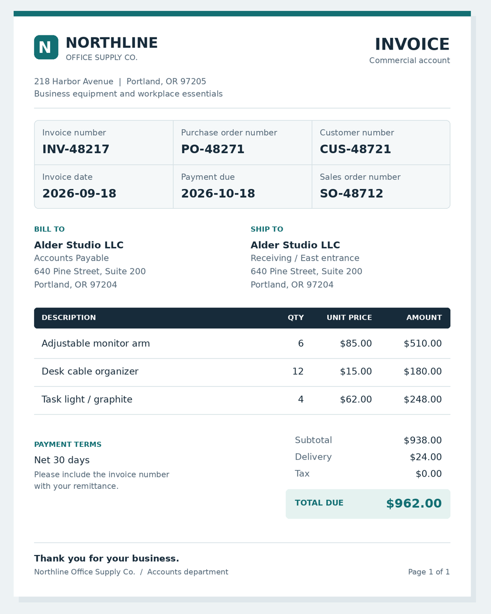

# Read the right field

Pair a business form label with its exact value despite neighboring reference fields.

## The ViewCraft skill

- **What to see (φ):** Read the complete form before choosing a value. If needed, crop the label and value together.
- **How to arrange it (ψ):** Keep columns, field boundaries and the page overview intact so neighboring identifiers stay distinct.
- **How to read it (θ):** Pair the requested label with its own value. Check nearby fields before returning the exact identifier.



**Question:** What is the purchase order number on this invoice?

**Recorded answer:** PO-48271

This is one illustrative case, not a benchmark accuracy claim. The preview shows
original inputs. Exact model attachments and responses remain in the case records.

## Use it

```bash
python scripts/use_skill.py --skill form-reading --record
```

For your own input add `--images my-image.png --question 'Your question'`.
For multi-image/video tasks provide ordered page images or extracted frames.
Use this directory as `initial_skill` to adapt it through `scripts/evolve.py`.
