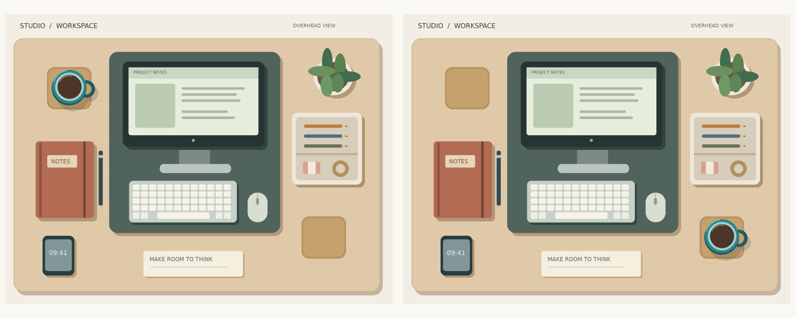

# Spot what changed

Compare aligned before and after desk scenes and identify the one object that moved or was replaced.

## The ViewCraft skill

- **What to see (φ):** Keep the input order, colors and aspect ratios. Compare both scenes before requesting matched detail crops.
- **How to arrange it (ψ):** Place the two views in an indexed, two-column comparison sheet while retaining source identities.
- **How to read it (θ):** Align stable landmarks. For a moved object, confirm both its old location and its new location.



**Question:** The first image is BEFORE and the second image is AFTER. Exactly one item has moved on this desk; all other items stayed in place. Which item moved? Answer only with its color and common object name.

**Recorded answer:** Teal mug

This is one illustrative case, not a benchmark accuracy claim. The preview shows
original inputs. Exact model attachments and responses remain in the case records.

## Use it

```bash
python scripts/use_skill.py --skill image-comparison --record
```

For your own input add `--images my-image.png --question 'Your question'`.
For multi-image/video tasks provide ordered page images or extracted frames.
Use this directory as `initial_skill` to adapt it through `scripts/evolve.py`.
