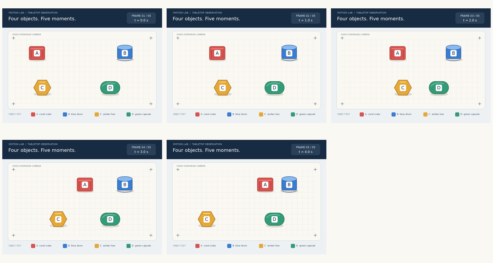

# Notice who stayed still

Compare labeled colored objects across five temporal frames, including an object that moves and returns to its starting position.

## The ViewCraft skill

- **What to see (φ):** Keep all supplied frames in time order. Preserve the scene's colors and object identities.
- **How to arrange it (ψ):** Use a time-labeled contact sheet so the same object can be compared across several moments.
- **How to read it (θ):** Track every object's position relative to stable landmarks. Returning to the start does not mean staying still.



**Question:** Which labeled objects remained at the same position in every one of the five frames? An object that moves and returns to its starting position does not count. Return only the labels in alphabetical order, separated by a comma and a space.

**Recorded answer:** B, D

This is one illustrative case, not a benchmark accuracy claim. The preview shows
original inputs. Exact model attachments and responses remain in the case records.

## Use it

```bash
python scripts/use_skill.py --skill motion-state --record
```

For your own input add `--images my-image.png --question 'Your question'`.
For multi-image/video tasks provide ordered page images or extracted frames.
Use this directory as `initial_skill` to adapt it through `scripts/evolve.py`.
