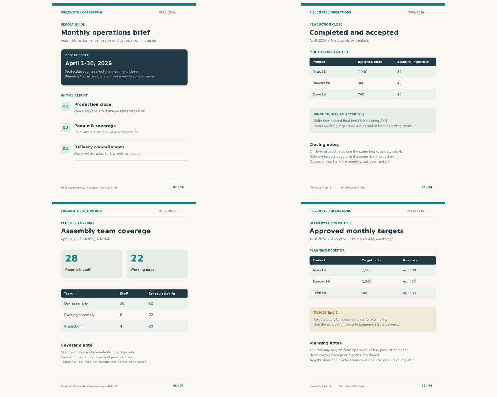

# Connect the pages

Locate the relevant pages in a short report and combine two visible facts into a concise answer.

## The ViewCraft skill

- **What to see (φ):** Retain the small report's page pool. Locate evidence by section headings and printed page numbers.
- **How to arrange it (ψ):** Keep pages individually addressable, with each fact tied to its source, period and units.
- **How to read it (θ):** Find the required facts on their own pages, check that their entities and units agree, then combine them.



**Question:** According to the April 2026 report, how many additional accepted Atlas kits were needed to meet the monthly target? Answer with the number only.

**Recorded answer:** 260

This is one illustrative case, not a benchmark accuracy claim. The preview shows
original inputs. Exact model attachments and responses remain in the case records.

## Use it

```bash
python scripts/use_skill.py --skill multi-page-qa --record
```

For your own input add `--images my-image.png --question 'Your question'`.
For multi-image/video tasks provide ordered page images or extracted frames.
Use this directory as `initial_skill` to adapt it through `scripts/evolve.py`.
