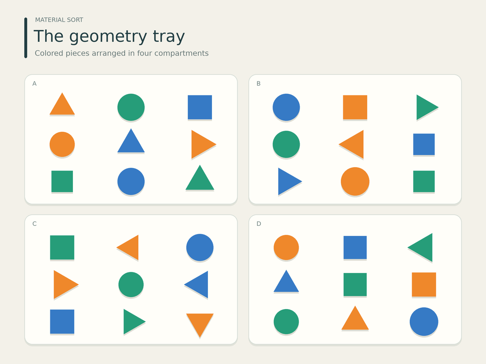

# Count without losing track

Count a requested color and shape using a compartment-by-compartment visual tally while excluding partial matches.

## The ViewCraft skill

- **What to see (φ):** Keep true RGB colors and object contours. Inspect only shapes whose color or boundary remains ambiguous.
- **How to arrange it (ψ):** Use the scene's compartments or nonoverlapping scan bands. A crop shows existing objects, not new ones.
- **How to read it (θ):** Match both color and shape. Count region by region, check boundaries, then combine the subtotals.



**Question:** How many orange triangles are there across all four compartments? Count only pieces that are both orange and triangular. Answer with only the integer.

**Recorded answer:** 7

This is one illustrative case, not a benchmark accuracy claim. The preview shows
original inputs. Exact model attachments and responses remain in the case records.

## Use it

```bash
python scripts/use_skill.py --skill object-counting --record
```

For your own input add `--images my-image.png --question 'Your question'`.
For multi-image/video tasks provide ordered page images or extracted frames.
Use this directory as `initial_skill` to adapt it through `scripts/evolve.py`.
