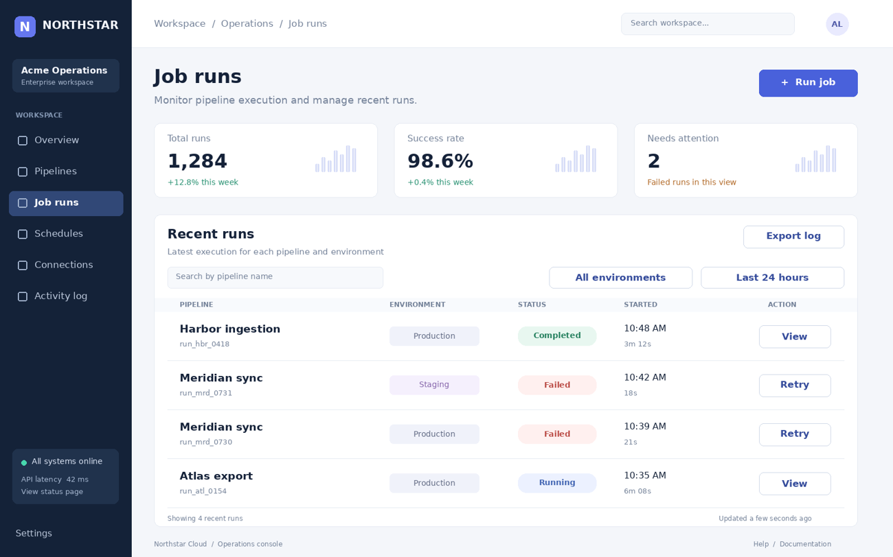

# Point to the right control

Resolve repeated GUI controls using task and environment labels, then return a normalized click point in the original screenshot.

## The ViewCraft skill

- **What to see (φ):** Inspect the original screenshot. Crop only when a repeated label or control is too small to distinguish.
- **How to arrange it (ψ):** Preserve source geometry and individually addressable views. Never rearrange interface fragments into a sheet.
- **How to read it (θ):** Match the row and section qualifiers, then choose the control's center and return a normalized source point.



**Question:** Locate the Retry button in the Meridian sync row whose environment is Production. Return its center as normalized (x, y) coordinates in the original screenshot.

**Recorded answer:** 0.8903, 0.7805

This is one illustrative case, not a benchmark accuracy claim. The preview shows
original inputs. Exact model attachments and responses remain in the case records.

## Use it

```bash
python scripts/use_skill.py --skill screen-grounding --record
```

For your own input add `--images my-image.png --question 'Your question'`.
For multi-image/video tasks provide ordered page images or extracted frames.
Use this directory as `initial_skill` to adapt it through `scripts/evolve.py`.
