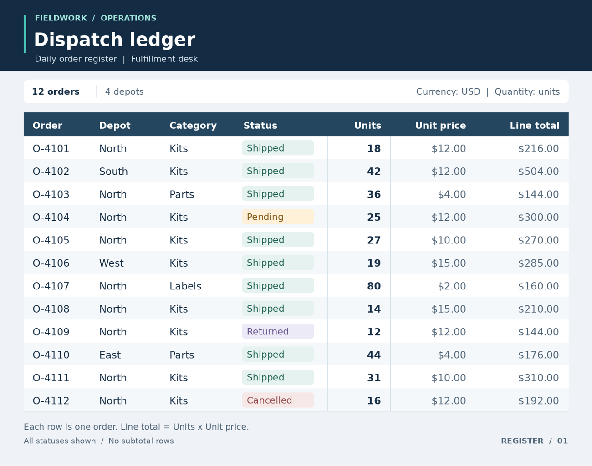

# Follow the right rows

Filter table rows by several conditions and total the requested numeric column while ignoring distractor records and measures.

## The ViewCraft skill

- **What to see (φ):** Read headers before numbers. Crop a row with its identifier, filter fields and target measure when necessary.
- **How to arrange it (ψ):** Preserve row alignment and column structure. Keep the overview available while checking a detail.
- **How to read it (θ):** Apply every filter, collect values from the correct column, and verify the selected rows before summing.



**Question:** What is the total number of units for orders where Depot is North, Category is Kits, and Status is Shipped? Add the Units column for matching rows only. Return only the number.

**Recorded answer:** 90

This is one illustrative case, not a benchmark accuracy claim. The preview shows
original inputs. Exact model attachments and responses remain in the case records.

## Use it

```bash
python scripts/use_skill.py --skill table-reasoning --record
```

For your own input add `--images my-image.png --question 'Your question'`.
For multi-image/video tasks provide ordered page images or extracted frames.
Use this directory as `initial_skill` to adapt it through `scripts/evolve.py`.
