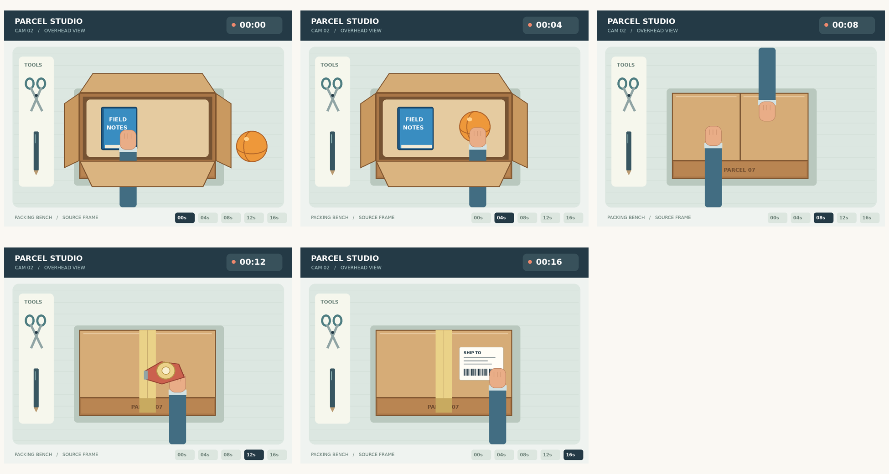

# Put the story in order

Find the event immediately before or after an anchor in timestamped scene frames.

## The ViewCraft skill

- **What to see (φ):** Retain the supplied event frames and timestamps. Inspect a specific source frame only when the event is unclear.
- **How to arrange it (ψ):** Arrange frames in a three-column, time-labeled sheet. Read timestamps rather than guessing from tile position.
- **How to read it (θ):** Locate the anchor event, then inspect its immediate neighbor. Distinguish an action from a persistent state.



**Question:** In this sequence, what happened immediately before the box was taped shut at 00:12? Answer with the letter of the matching event.

**Recorded answer:** B

This is one illustrative case, not a benchmark accuracy claim. The preview shows
original inputs. Exact model attachments and responses remain in the case records.

## Use it

```bash
python scripts/use_skill.py --skill temporal-order --record
```

For your own input add `--images my-image.png --question 'Your question'`.
For multi-image/video tasks provide ordered page images or extracted frames.
Use this directory as `initial_skill` to adapt it through `scripts/evolve.py`.
